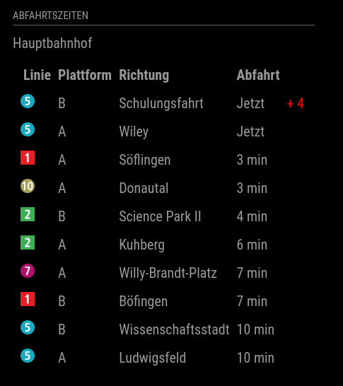

# MM2-PublicTransport-SWU

This a module for the [MagicMirror](https://github.com/MichMich/MagicMirror). It can display the departues of trains and busses of the SWU region in Ulm, Germany.

## Installation

In terminal, go to your MagicMirror's Module folder:
```
cd ~/MagicMirror/modules
```

Clone this repository:
```
git clone https://github.com/ChrwagnerTHU/MMM-PublicTransport-SWU
```

## Updating

In terminal, go to the Module's folder and pull the latest version from GitHub:
```
cd ~/MagicMirror/modules/MMM-PublicTransport-SWU
git pull
```

## Configuration options

### Main config
|Option|Default|Description|
|---|---|---|
|`stopNumber`|1008|ID of stop you want to display.|
|`stopString`|"Hauptbahnhof"|Name of stop you want to display.|
|`limit`|10|Maximum number of departures to display.|
|`maxMinutes`|0|Only show departures within this many minutes from now. `0` disables the limit.|
|`updateInterval`|60000|Update interval (in ms)|
|`showDelay`|`false`|Show delay of departure (in m)|
|`showPlattform`|[]|Array of plattform ids to be displayed.<br>Examples:<br>['A'] - only plattform A<br>['A','B'] - plattforms A and B<br>[] - all plattforms|
|`timetostop`|5|Number of minutes you need to reach the stop (affects table coloring).|
|`provider`|"auto"|Data source: `"auto"` (SWU first, DING as fallback), `"swu"` or `"ding"`. See [Data sources](#data-sources).|
|`dingBaseUrl`|"https://www.ding.eu/ding3/XSLT_DM_REQUEST"|Endpoint of the DING journey planner.|
|`dingStopPrefix`|"de:08421"|Stop ID prefix of the DING. `de:08421` is Ulm, `de:09775` is Neu-Ulm.|

## Data sources

The departures are fetched by a node helper on the MagicMirror server, not by the browser, so cross-origin restrictions do not apply.

|`provider`|Source|Note|
|---|---|---|
|`swu`|`api.swu.de`|The official SWU interface.|
|`ding`|[DING](https://www.ding.eu/) journey planner (EFA)|Delivers the same SWU realtime data via the regional transport association. The SWU stop numbers are also the DING stop IDs, so `stopNumber` stays the same.|
|`auto`|both|Tries the SWU interface first and switches to DING if it is unavailable.|

> **Note:** As of October 2026 the host `api.swu.de` no longer resolves in DNS, so the official interface cannot be reached. With the default `provider: "auto"` the module falls back to DING automatically and switches back on its own as soon as the SWU interface is reachable again.

## Using the module

To use this module, add it to the modules array in the `~/MagicMirror/config/config.js` file.

### Example
```
    {
        module: "MMM-PublicTransport-SWU",
        header: "Abfahrtszeiten",
        position: "bottom_left",
        config: {
            stopNumber: 1008,
            stopString: "Hauptbahnhof",
            limit: 5,
            maxMinutes: 90,
            updateInterval: 60000,
            timetostop: 5,
        }
    },
```
To figure out the stop id of the stop you want to display, search the stop in the [DING journey planner](https://www.ding.eu/). The stop IDs have the form `de:08421:1008` — the last part is your `stopNumber`.
### Table coloring
The departure table colors the countdown based on your `timetostop` value:
- **Red**: Departure is less than `timetostop - 1` minutes away (too soon to reach).
- **Gold**: Departure is within ±1 minute of your `timetostop` (perfect timing).
- **Default**: All other cases.
#### Screenshot


## Special Thanks
- [Michael Teeuw](https://github.com/MichMich) for creating the awesome [MagicMirror2](https://github.com/MichMich/MagicMirror/tree/develop) project that made this module possible.
